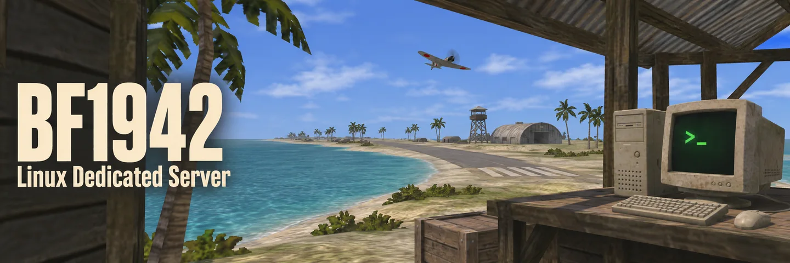
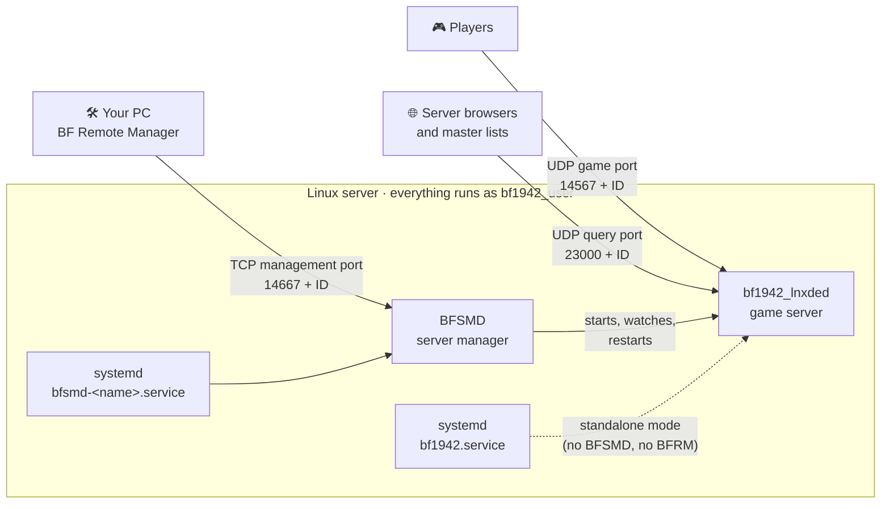
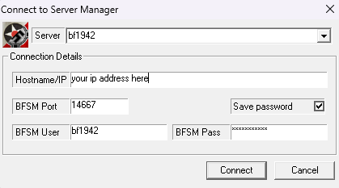
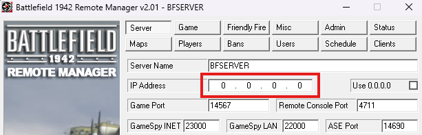
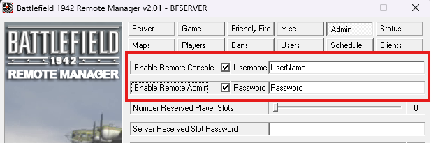
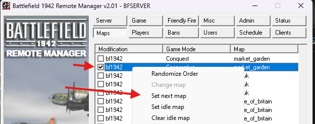
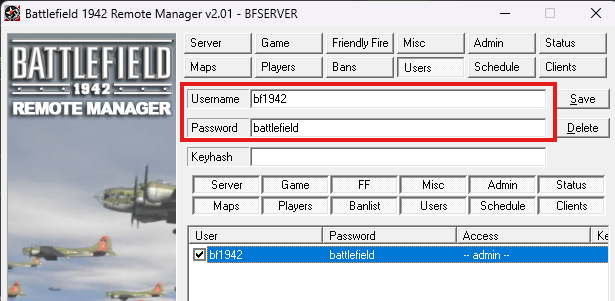
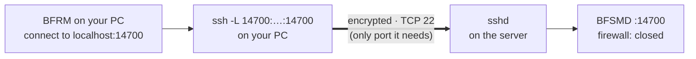
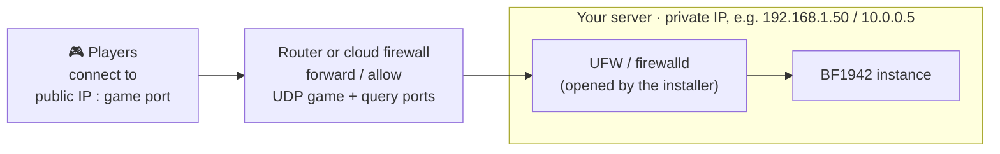

<p align="center">
  
</p>

# 🪖 Battlefield 1942 Dedicated Server (Linux)

Automated setup for running **Battlefield 1942 Dedicated Servers** on modern 64-bit Linux with **multi-instance support**. Handles all dependency resolution (including legacy 32-bit libraries), user creation, systemd service setup, and firewall configuration in a single interactive script.

---

## 🧩 Overview

- **Single-script setup** — one script handles everything: standalone or BFSMD managed mode
- **Download only what you need** — `install.sh` detects your distro and fetches just that installer
- **Multi-instance support** — run multiple servers on one machine with automatic port allocation
- **Smart configuration** — interactive IP detection, port conflict prevention, resource validation
- **Performance optimized** — CPU affinity, memory limits, and I/O tuning per instance
- **Secure by default** — runs under a dedicated non-privileged account (`bf1942_user`)
- **Firewall integration** — UFW on Debian/Ubuntu, firewalld on Fedora/RHEL/CentOS/openSUSE
- **Systemd managed** — standard `systemctl` commands for all service control
- **Shared management tool** — one `bf1942_manager.sh` at the repo root works across all distros

### How it fits together



In **BFSMD mode** each instance is its own systemd service running BFSMD, which launches the game server and lets you administer it remotely with BFRM. **Standalone mode** runs one game server directly under systemd on the stock ports. Each instance's ports are worked out from its ID — see [Automatic Port Allocation](#automatic-port-allocation).

---

## 🧪 Installer Targets

| Distro | Script |
|--------|--------|
| **Arch Linux** (and EndeavourOS, Manjaro, ...) | `installers/arch/arch_bfsmd_setup.sh` |
| **Ubuntu 26.04 LTS** *(runtime validation pending)* | `installers/ubuntu/ubu_26.04_bfsmd_setup.sh` |
| **Ubuntu 24.04 LTS** | `installers/ubuntu/ubu_24.0.3_bfsmd_setup.sh` |
| **Ubuntu 22.04 LTS** | `installers/ubuntu/ubu_22.04_bfsmd_setup.sh` |
| **Debian 12 (Bookworm) / 13 (Trixie)** | `installers/debian/deb_12_bfsmd_setup.sh` |
| **Fedora 43 – 45** *(runtime validation pending)* | `installers/fedora/fed_44_bfsmd_setup.sh` |
| **RHEL 9 / Rocky 9 / AlmaLinux 9 / Oracle Linux 9** | `installers/rhel/rhel_9_bfsmd_setup.sh` |
| **CentOS Stream 9** | `installers/centos/centos_stream9_bfsmd_setup.sh` |
| **openSUSE Leap 16 / Tumbleweed** *(runtime validation pending)* | `installers/opensuse/opensuse_bfsmd_setup.sh` |

`install.sh` also picks the right script for derivatives: Linux Mint, Pop!_OS, Zorin and other Ubuntu-based distros get the installer for the Ubuntu release they're built on.

Fedora has no LTS release; the RHEL 9 installer is the longer-support option.

> ⚠️ **Not supported: Enterprise Linux 10** (RHEL / Rocky / AlmaLinux / CentOS Stream 10). EL 10 dropped every 32-bit (i686) package, and the BF1942 server is a 32-bit program, so it has nothing to run on. The installers and `install.sh` stop with an explanation instead of half-installing. Use an EL 9 release (supported until 2032) or another distro above.

---

## 🚀 Quick Start

> **Prerequisite:** A user with **sudo** privileges

### 1️⃣ Download & Run (auto-detect)

The launcher detects your distro and downloads **only** the matching installer plus `bf1942_manager.sh` into the current directory — nothing else from the repo:

```bash
curl -fsSLO https://raw.githubusercontent.com/hootmeow/bf1942-linux/main/install.sh
sudo bash install.sh                 # interactive
sudo bash install.sh server1 --yes   # any installer arguments are passed straight through
```

It picks the installer from `/etc/os-release` (derivatives such as Rocky/Alma, Linux Mint or EndeavourOS map to their parent distro). The downloaded installer stays in the current directory, so later runs (`sudo ./<script>.sh server2`) don't need the launcher. Set `BF1942_LINUX_REF=<tag or commit>` to pin a specific version.

### 1️⃣ *(alternative)* Download Manually

Pick your distro's script from the table above, then download it along with the management tool:

```bash
# Example: Ubuntu 24.04
wget https://raw.githubusercontent.com/hootmeow/bf1942-linux/main/installers/ubuntu/ubu_24.0.3_bfsmd_setup.sh
wget https://raw.githubusercontent.com/hootmeow/bf1942-linux/main/bf1942_manager.sh
chmod +x ubu_24.0.3_bfsmd_setup.sh bf1942_manager.sh
```

Replace `ubu_24.0.3_bfsmd_setup.sh` with your distro's script name from the table above. `bf1942_manager.sh` is the same file for all distros — you only need one copy.

### 2️⃣ Run the Installer

```bash
sudo ./<your-setup-script>.sh        # or: sudo bash install.sh
```

The script is interactive by default. It will walk you through:

1. **Installation mode** — choose Standalone (no remote management) or BFSMD (full GUI management via BFRM)
2. **Instance name** *(BFSMD only)* — a unique name like `server1`, `conquest`, `tdm`
3. **Server name** — what players see in the server browser (default `BF1942 <instance>`, max 32 characters)
4. **IP address** — auto-detected; choose local, public, or enter custom
5. **BFSMD version** *(BFSMD only)* — v2.0 (recommended) or v2.01 (fixes admin/PunkBuster bugs)
6. **Firewall rules** — rules are created for the ports this instance was assigned (see [Ports](#️-ports--configuration)). If ufw/firewalld is **already active** (e.g. enabled by an earlier install), opening them is the default, since the new server would otherwise be unreachable; if you decline, the exact commands to open them are printed.

Package installs run quietly behind a one-line spinner; their full output goes to `/var/log/bf1942-install.log` (pass `--verbose` to see it live). If a step fails, its last 20 lines are shown.

After starting the service the installer **waits up to 90 seconds for the game server to answer a real query**, so "done" means players can actually join. The final screen then shows everything on one page: where players connect (including the public address and what to forward when the server sits behind NAT), the BFRM address/tunnel command and login, the remote-console password, what the firewall step did, all ports, and next steps. The installer exits non-zero if the service isn't running. The generated sudoers rules are checked with `visudo -c` before being installed, so a bad file can never lock you out of `sudo`.

The `bf1942_user` service account is created without a password (login locked) unless you opt in when asked — a password isn't needed to run the server, and admins can always get a shell with `sudo su - bf1942_user`.

### Unattended Installs

Every prompt can be answered from the command line — pass `--yes` and the installer never stops to ask:

```bash
sudo ./<your-setup-script>.sh server1 --yes                        # BFSMD, local IP, v2.0, firewall untouched
sudo ./<your-setup-script>.sh server1 --yes --ip public --firewall tunnel
sudo ./<your-setup-script>.sh --yes --mode standalone
```

| Flag | Values | Default with `--yes` |
|------|--------|----------------------|
| `--mode` | `standalone`, `bfsmd` | `bfsmd` when an instance name is given |
| `--ip` | `local`, `public`, literal address | `local` |
| `--version` | `2.0`, `2.01` | `2.0` |
| `--firewall` | `skip`, `open`, `tunnel`, `restrict=ADDR` | `skip`, or `tunnel` (game ports opened, management closed) when ufw/firewalld is already active |
| `--name` | server-browser name, max 32 chars, no quotes/backslashes | `BF1942 <instance>` (standalone keeps the shipped name) |
| `--repair` / `--reinstall` | flag | `--repair` when the instance already exists (see below) |
| `--patches` / `--no-patches` | flag | Skipped; `--patches` applies the CTF bug fixes (see Applying Patches) during the install |
| `--verbose`, `-v` | flag | Off; package output only goes to the install log |
| `--allow-unverified-downloads` | flag | Off; supply it to continue after a hash warning |

Run any installer with `--help` for the full reference. The flags also work without `--yes` to pre-answer individual prompts in an otherwise interactive run.

### Repairing or Reinstalling an Existing Server

Running the installer again with an existing instance name (or `--mode standalone` when the standalone server exists) offers:

- **Repair** *(default)* — keeps the server files, maps, settings, BFRM accounts and a changed remote-console password; rewrites the systemd unit, sudo rules and firewall rules, re-applies the instance's assigned ports, and restarts it. The bind IP is kept unless you pass `--ip`. Edited `.con` files are copied to `*.pre-repair` first.
- **Reinstall** — downloads fresh server files over the old ones; the current settings folder is kept as `mods/bf1942/settings.pre-reinstall-<date>`.

```bash
sudo ./<your-setup-script>.sh server1 --repair --yes
```

### 3️⃣ Add More Instances *(BFSMD Only)*

```bash
sudo ./<your-setup-script>.sh server2
sudo ./<your-setup-script>.sh hootmeow
```

Each instance automatically gets unique ports, its own systemd service, and dedicated CPU cores when available.

### Distro-Specific Notes

| Distro | Key Differences |
|--------|----------------|
| Arch Linux | Needs `[multilib]` enabled; uses the static server binary with a local ncurses shim (no legacy packages) |
| Ubuntu 22.04 / 24.04 / 26.04 | Auto-detects `libcurl4` vs `libcurl4t64:i386` at runtime |
| Debian 12/13 | Auto-detects `libcurl4` vs `libcurl4t64` at runtime |
| Fedora 44 | `dnf` + `.i686` packages, firewalld, SELinux (`restorecon`), zlib-ng auto-detection |
| RHEL 9 (+ Rocky / Alma / Oracle) | Same as Fedora + automatically enables EPEL and CRB repos |
| CentOS Stream 9 | Same as RHEL 9 |
| openSUSE Leap 16 / Tumbleweed | `zypper` + native `-32bit` packages (including `libncurses5`), firewalld, SELinux (`restorecon`) |

---

## 🎮 Connect to BFRM (BFSMD Mode)

After installation, all servers use the same default credentials:

```text
Username: bf1942
Password: battlefield
```

⚠️ **Change this password immediately after first login.**

The installer also saves a per-instance summary to `/root/.bf1942_credentials_<name>.txt` and appends every generated secret — including the remote-console password (see below) — to `/root/.bf1942_all_credentials.txt` on the server.

### Steps

1. Open **BFRM client** on Windows
2. Connect to `your-server-ip:management-port`
3. Login with the default credentials above
4. Go to **Admin tab → Change Password**



### First-Time Configuration in BFRM

**Set the server IP** — navigate to IP settings and set your server's IP explicitly:



**Secure the remote console** — the installer already sets a unique remote-console login per instance (username `bfadmin`, random password saved to `/root/.bf1942_all_credentials.txt`). Use this screen to change it or add further console admins:



**Set the map rotation** — new installs are seeded with Berlin (Conquest) so the server starts immediately; use this screen to build your own rotation:



**Update admin passwords** — create secure admin accounts and disable the defaults:



---

## 🛠️ Managing Servers

`bf1942_manager.sh` lives at the repo root and manages all instances regardless of which distro installed them.

**Interactive menu:** run it with no command (`sudo ./bf1942_manager.sh`) for a menu that shows every server live (online / stopped, map, players) and does everything below without remembering commands — start/stop, logs, backups and restores, bug-fix patches and the replay recorder. Ctrl+C stops a live log and returns to the menu.

```bash
./bf1942_manager.sh list                  # All instances and their status
./bf1942_manager.sh ports                 # All six ports of every instance
./bf1942_manager.sh status server1        # Service status, ports, and live server info (map, players)
./bf1942_manager.sh config server1        # Show config file paths
./bf1942_manager.sh health                # Queries each game server - not just "is systemd running"
./bf1942_manager.sh security              # Security audit (passwords, ownership, firewall)
./bf1942_manager.sh logs server1          # Live log tail (Ctrl+C to exit)

sudo ./bf1942_manager.sh start server1
sudo ./bf1942_manager.sh stop server1
sudo ./bf1942_manager.sh restart server1
sudo ./bf1942_manager.sh start-all
sudo ./bf1942_manager.sh stop-all
sudo ./bf1942_manager.sh backup server1   # Full backup incl. systemd unit + sudoers
sudo ./bf1942_manager.sh restore <file>   # Rebuild an instance from a backup (here or on a new machine)
sudo ./bf1942_manager.sh remove server2   # Removes instance + its firewall rules (asks for confirmation)

sudo ./bf1942_manager.sh patch            # Bug-fix patches: which servers need which (see Applying Patches)
sudo ./bf1942_manager.sh patch all        # Apply them; or: patch server1, patch all --check
sudo ./bf1942_manager.sh recorder         # bfstats.io replay recorder menu
sudo ./bf1942_manager.sh update           # Update this manager and the patch files from GitHub
```

**Health check:** `health` and `status` send a GameSpy `\status\` query to each instance's query port. A running systemd unit only proves BFSMD is up — the game server it launches can still be crashed, stuck loading, or refusing to start — so an instance only counts as healthy when the game itself answers (and you see its map and player count).

### Direct Systemd Commands

```bash
# Standalone server
sudo systemctl status bf1942.service
journalctl -u bf1942.service -f

# BFSMD instance
sudo systemctl status bfsmd-server1.service
journalctl -u bfsmd-server1.service -f
```

---

## ⚙️ Ports & Configuration

### Automatic Port Allocation

Each instance gets a unique ID (1–99), derived from its name. IDs are recorded in `/etc/bf1942_instances.conf`; if a new name would produce an ID that is already taken, the next free ID is used automatically, so two instances can never be assigned the same ports (ID 0 is reserved — it belongs to the standalone server's default ports).

| Port | Formula | Example (`server1`) | Open in firewall? |
|------|---------|---------------------|-------------------|
| Game (UDP) | 14567 + ID | 14600 | **Yes** — players connect here |
| Query (UDP) | 23000 + ID | 23033 | **Yes** — server browsers / master list |
| Management (TCP) | 14667 + ID | 14700 | Admins only — restrict to your IP or SSH-tunnel |
| Remote console (TCP) | 4711 + ID | 4744 | No — SSH-tunnel if needed |
| GameSpy LAN (UDP) | 22000 + ID | 22033 | No — LAN discovery only |
| ASE (UDP) | 14690 + ID | 14723 | No — ASE master service is defunct |

The installer's firewall step opens exactly these per-instance ports (game + query, plus management according to the option you choose). The standalone server uses the stock ports (ID 0): 14567, 23000, 22000, 14690.

```bash
./bf1942_manager.sh ports   # See all current assignments, all six ports
```

### Configuration Files

All filenames are lower-case — the stock `fixinstall.sh` lower-cases the entire tree during installation.

**Standalone server:**
```
/home/bf1942_user/bf1942/mods/bf1942/settings/
├── serversettings.con   # Game settings
└── maplist.con          # Map rotation
```

**BFSMD instance:**
```
/home/bf1942_user/instances/<name>/mods/bf1942/settings/
├── servermanager.con    # BFSMD settings (ports, console login)
├── useraccess.con       # Admin accounts
├── serversettings.con   # Game settings
└── servermaplist.con    # Map rotation (BFSMD reads this, not maplist.con)
```

**Editing config:**
```bash
nano /home/bf1942_user/instances/server1/mods/bf1942/settings/serversettings.con
# Restart to apply:
sudo systemctl restart bfsmd-server1.service
```

---

## 📊 XML Event Logging

The game server can log every in-game event (kills, scores, round stats) to XML files — the data source for player-statistics tools. Logs are written per round to:

```
<server-root>/mods/<active mod>/logs/ev_<port>-<date>_<time>.xml
```

The logging flags live in the base `mods/bf1942/settings` files, but the engine writes the log files under whichever mod the server is actually running (e.g. `mods/dc_final/logs/` for a Desert Combat server). Stats collectors should watch `mods/*/logs/`, not a single hardcoded path.

**New installs:** event logging is enabled automatically by the setup scripts (`game.serverEventLogging 1`, compression off).

### Enabling Logging on Existing Servers

Servers installed with an older version of the setup scripts have logging disabled. To enable it without touching any other settings:

```bash
wget https://raw.githubusercontent.com/hootmeow/bf1942-linux/main/patches/patch-existing-logging.sh
chmod +x patch-existing-logging.sh

sudo ./patch-existing-logging.sh                  # auto-detect installs under /home/bf1942_user
sudo ./patch-existing-logging.sh /path/to/server  # or pass server root(s) explicitly
```

The script sets `game.serverEventLogging 1` and `game.serverEventLogCompression 0` in `serversettings.con` and (on BFSMD installs) `servermanager.con`. Ports, server name, credentials, and map rotation are left exactly as they are, and every edited file is backed up first as `<name>.bak-logging-<timestamp>`.

Then restart the server to apply:

```bash
sudo systemctl restart bf1942.service            # standalone
sudo systemctl restart bfsmd-<name>.service      # BFSMD instance
```

**To do it by hand instead**, edit `mods/bf1942/settings/serversettings.con` (and `servermanager.con` on BFSMD installs) and set:

```text
game.serverEventLogging 1
game.serverEventLogCompression 0
```

### Logging Notes

- **Keep compression off.** Compressed `.zxml` logs are flushed to disk in deferred blocks — a server stop or crash can lose the entire round, and stats tools expect plain `.xml`.
- One file is written per round and closed with `</bf:log>` when the round ends. Stopping or restarting the server kills the game process hard, so the file for an in-progress round is always left truncated — only completed rounds produce well-formed logs.
- The `logs` folder is created automatically by the engine on first start, inside the active mod's directory.

---

## 🔒 Security

### Post-Installation Checklist
1. ✅ Log in to BFRM with default credentials
2. ✅ Change password immediately (Admin tab)
3. ✅ Create unique admin accounts
4. ✅ Disable or remove the default `bf1942` account
5. ✅ Restrict firewall access to the management port

### Management Port Security Options

The installer asks how to handle the management port:

| Option | Description | Best For |
|--------|-------------|----------|
| Open to all | Anyone can attempt to connect (still requires password) | Testing, behind another firewall |
| Restrict to IP | Only your specified IP can connect | Static admin IP |
| SSH tunnel | Port not opened at all; tunnel through SSH | Maximum security |

**SSH tunnel:** the management port stays closed in the firewall; BFRM reaches it through your SSH connection instead.



```bash
# On your local machine:
ssh -L 14700:localhost:14700 user@your-server-ip
# Then point BFRM at localhost:14700
```

### Security Audit
```bash
./bf1942_manager.sh security
```
Checks process ownership, file permissions, default password still in use, and firewall status.

---

## 🌐 Network Scenarios

Most servers sit behind something that filters traffic before it reaches the machine — a home router, or a cloud provider's firewall / security group. The game and query ports have to be allowed at **every** layer:



The installer handles the server's own firewall; the router / cloud layer is yours to set up. Its final screen prints the exact ports and both addresses (public and private) to use.

### Home Server (Behind Router)
- Choose **Local IP** during setup
- Forward Game + Query ports (UDP) on your router
- Players connect to your public IP

### Cloud Server (AWS, DigitalOcean, etc.)
- Choose **Local IP** (private IP like `10.x.x.x`)
- Allow Game + Query ports from anywhere in the cloud firewall
- Allow Management port from your IP only
- Players connect to the instance's public IP

### VPS with Direct Public IP
- Choose **Public IP** if the server has no NAT
- Use UFW / firewalld to restrict management port access

---

## 🔧 Troubleshooting

### "Internal error!" in Logs
Normal — BFSMD v2.0/v2.01 produces these continuously on modern kernels when reading `/proc`. The server works fine regardless. Filter them out with:
```bash
journalctl -u bfsmd-server1.service -f | grep -v "Internal error"
```

### Can't Connect to Server
```bash
systemctl is-active bfsmd-server1.service   # Is it running?
sudo ufw status                              # Firewall open? (Debian/Ubuntu)
sudo firewall-cmd --list-ports               # Firewall open? (Fedora/RHEL/CentOS)
sudo ss -tulnp | grep 14567                  # Port actually listening?
./bf1942_manager.sh logs server1             # Check logs
```

### Port Conflict During Install
- Instance IDs (and therefore ports) are recorded in `/etc/bf1942_instances.conf` — the installer probes for a free ID automatically, so a conflict means something outside this tool is using the port
- Check what's already assigned: `./bf1942_manager.sh ports`

### Can't Login to BFRM
1. Confirm credentials: `bf1942` / `battlefield`
2. Confirm the management port number (`./bf1942_manager.sh ports`)
3. Confirm firewall allows the connection
4. Confirm the service is running

---

## 🛠️ Advanced Usage

### Instance Limits

The script warns if you exceed the recommended ceiling but won't block you:

| CPU Cores | Recommended Max Instances |
|-----------|--------------------------|
| 2 | 4 |
| 4 | 8 |
| 8 | 16 |

### Backup & Restore

The manager creates a full backup — the instance directory plus a `<name>.meta/` folder containing the systemd unit, sudoers file, and registry entry, so the instance can be rebuilt on a clean machine:

```bash
sudo ./bf1942_manager.sh backup server1
# → /root/bf1942_backups/bf1942_server1_backup_<timestamp>.tar.gz

sudo ./bf1942_manager.sh restore /root/bf1942_backups/bf1942_server1_backup_<timestamp>.tar.gz
```

`restore` puts back the instance files, systemd unit, sudoers rules (validated with `visudo`) and the registry entry, so the instance keeps its original ID and ports. It:

- refuses to overwrite an existing instance — `backup` and `remove` it first if you're rolling back
- refuses if another instance already holds the same ID (they would share ports)
- on a new machine, needs the installer to have run once (32-bit libraries + `bf1942_user`), and warns if the service is bound to an IP that machine doesn't have
- offers to open the game ports if a firewall is active, then asks whether to start the server

Backups made before restore support (no `<name>.meta/` folder) can't be restored automatically; the command prints the manual `tar` step instead.

For a quick settings-only snapshot:
```bash
sudo tar -czf server1-settings-$(date +%F).tar.gz \
  /home/bf1942_user/instances/server1/mods/bf1942/settings/

# Restore settings
sudo tar -xzf server1-settings-*.tar.gz -C /
sudo systemctl restart bfsmd-server1.service
```

### Clone Instance Settings
```bash
sudo cp -r /home/bf1942_user/instances/server1/mods/bf1942/settings/* \
           /home/bf1942_user/instances/server2/mods/bf1942/settings/
# Update the ports in serversettings.con and servermanager.con, then restart server2
```

---

## 📁 Repository Structure

```
bf1942-linux/
├── install.sh                 # Launcher: detects the distro, fetches only its installer
├── bf1942_manager.sh          # Shared management tool (all distros)
├── installers/                # GENERATED from src/ - one self-contained script per distro
│   ├── arch/
│   │   └── arch_bfsmd_setup.sh
│   ├── ubuntu/
│   │   ├── ubu_26.04_bfsmd_setup.sh
│   │   ├── ubu_24.0.3_bfsmd_setup.sh
│   │   └── ubu_22.04_bfsmd_setup.sh
│   ├── debian/
│   │   └── deb_12_bfsmd_setup.sh
│   ├── fedora/
│   │   └── fed_44_bfsmd_setup.sh
│   ├── rhel/
│   │   └── rhel_9_bfsmd_setup.sh
│   ├── centos/
│   │   └── centos_stream9_bfsmd_setup.sh
│   └── opensuse/
│       └── opensuse_bfsmd_setup.sh
├── src/                       # Installer source (edit here, then run src/build.sh)
│   ├── build.sh                    # Assembles installers/ from the pieces below
│   ├── installer.sh.in             # Shared installer template
│   ├── common/                     # Default fragments
│   ├── families/{apt,dnf,el}/      # Fragments shared by a distro family
│   └── distros/<distro>/           # distro.conf + distro-only fragments (header, deps, ...)
├── patches/
│   ├── apply_patches.sh            # Runner: checks + applies every patch below, per instance
│   ├── patch_ctf_flags_map.py      # Binary patch: dropped CTF flags land on objects, not through them
│   ├── patch_ctf_respawn.py        # Binary patch: CTF flag respawn timer resets on pickup
│   ├── patch-existing-logging.sh   # Config patch: enable XML event logging on existing installs
│   └── install-replay-recorder.sh  # Optional add-on: bfstats.io replay recorder (run separately)
├── firewall_guide.md
├── LICENSE
└── readme.md
```

---

## 🛠️ Applying Patches

The `patches/` folder holds fixes for known server bugs. The easiest way to apply them is the manager — it works on any server, even when you only downloaded the installer, because it fetches the patch files itself (to `/opt/bf1942-linux/patches`, refreshed daily) and installs `python3` if the binary patches need it:

```bash
sudo ./bf1942_manager.sh patch                    # overview: every instance x every patch (needed / applied)
sudo ./bf1942_manager.sh patch all                # apply whatever is needed, on every instance
sudo ./bf1942_manager.sh patch server1 --check    # report only ('default' = standalone server)
```

The installer also offers them near the end of a fresh install (answer *y*, or pass `--patches`), and `bf1942_manager.sh health` lists servers that still have patches waiting.

From a git clone you can also run the patch runner directly — `apply_patches.sh` applies **all of them** in one go, no need to run each script by hand:

```bash
sudo ./patches/apply_patches.sh                   # overview: every instance x every patch (needed / applied)
sudo ./patches/apply_patches.sh all               # apply whatever is needed, on every instance
sudo ./patches/apply_patches.sh server1 server2   # specific instances ('standalone' = standalone server)
sudo ./patches/apply_patches.sh all --check       # report only, change nothing
sudo ./patches/apply_patches.sh all --only patch_ctf_respawn
```

| Patch | Type | What it fixes |
|-------|------|---------------|
| `patch_ctf_flags_map` | binary | A dropped CTF flag falls through buildings/bridges to the terrain; patched, it lands on the object (and stays above water) |
| `patch_ctf_respawn` | binary | The flag's 30 s respawn countdown isn't reset when it's picked up again; patched, it resets on every pickup |
| `patch-existing-logging` | config | Enables uncompressed XML event logging on installs made before it was the default ([details](#-xml-event-logging)) |

For each instance the runner checks first and only touches instances that need something. Then it stops the service, backs up both server binaries (`bf1942_lnxded.*.orig` = the binary before the runner first patched it, plus a timestamped `*.pre-patch-<date>` copy every run), applies the patches, and starts the service again if it was running. Any new `patch_*.py` (binary) or `patch-*.sh` (config) file dropped into the folder is picked up automatically.

**Safety & provenance**
- The binary patches come from [uuuzbf/bf1942-patches](https://github.com/uuuzbf/bf1942-patches); offsets and bytes are identical to upstream.
- They were verified against all three server archives the installers download: the original bytes match at every offset in both `.static` and `.dynamic`, only the documented byte ranges change, and re-running is a no-op.
- Each patch verifies the original bytes before writing and refuses a binary it doesn't recognise (`[MISMATCH]`), so a different build is never corrupted.
- To undo: stop the service and copy `bf1942_lnxded.<static|dynamic>.orig` back over the patched file. (If you had patched a binary by hand before ever using the runner, `.orig` holds that hand-patched copy.)

> ⚠️ **Replay recorder:** the bfstats.io recorder (`install-replay-recorder.sh`) only hooks the *unmodified* `bf1942_lnxded.static`. The runner therefore **skips binary patches on instances that have the recorder installed** — pass `--with-recorder` to patch them anyway (recordings will stop working on those instances).
>
> `install-replay-recorder.sh` always installs the **newest `recorder-v*` release** from [sila-skandia/bfstats](https://github.com/sila-skandia/bfstats/releases) and checks it against the release's `recorder.so.sha256`. Its menu shows each server's installed version, flags when a newer release is out, and offers **Update all**; each server also has a *Clean up old replays* option (replays otherwise grow forever). Pin a version with `sudo RECORDER_TAG=recorder-v0.3.0 bash install-replay-recorder.sh`.
>
> To keep recorders current and the disk in check without logging in, run it from cron — `--update` updates every installed recorder (keeping each server's on/off and sample-rate settings, restarting only servers that were running), and `--prune-replays N` deletes replays older than N days:
>
> ```bash
> # /etc/cron.d/bf1942-recorder
> 30 5 * * * root /path/to/patches/install-replay-recorder.sh --update --prune-replays 30 >> /var/log/bf1942-recorder.log 2>&1
> ```

---

## 📥 BFRM Downloads (Windows Client)

1. **BFRM v2.0 (Final)** — Recommended  
   https://files.bf1942.online/server/tools/BFRemoteManager20final-patched.zip

2. **BFRM v2.01 (Patched)** — Fixes unauthorized admin and PunkBuster bugs  
   https://files.bf1942.online/server/tools/BFRemoteManager201-patched.zip

---

## 📚 Additional Resources

- **firewall_guide.md** — detailed firewall configuration reference
- **captheflag.com** — community site: server browser, stats, and leaderboards
- **files.bf1942.online** — server and BFRM downloads

---

## 🧑‍🎨 Author

**OWLCAT**  
🔗 https://github.com/hootmeow  
🌐 https://captheflag.com

---

## 🤝 Contributing

1. **Installers are generated** — edit `src/`, never `installers/` directly:
   - shared behaviour → `src/installer.sh.in` or `src/common/`
   - a distro family (apt / dnf / EL) → `src/families/<family>/`
   - one distro → `src/distros/<distro>/` (its `distro.conf` lists the fragment search order)
2. Rebuild and verify: `./src/build.sh`, then `./src/build.sh --check` (fails if `installers/` is out of date)
3. Test changes on the relevant distribution(s)
4. Update documentation and submit a pull request (commit `src/` and the regenerated `installers/` together)

---

## 📜 License

Scripts released under the **MIT License** — see [LICENSE](LICENSE).  
All Battlefield 1942 game assets remain © Electronic Arts Inc.

---

## 🆘 Support

**Issues:** https://github.com/hootmeow/bf1942-linux/issues  
**Community:** https://captheflag.com

---

**Happy Gaming! 🎮**
